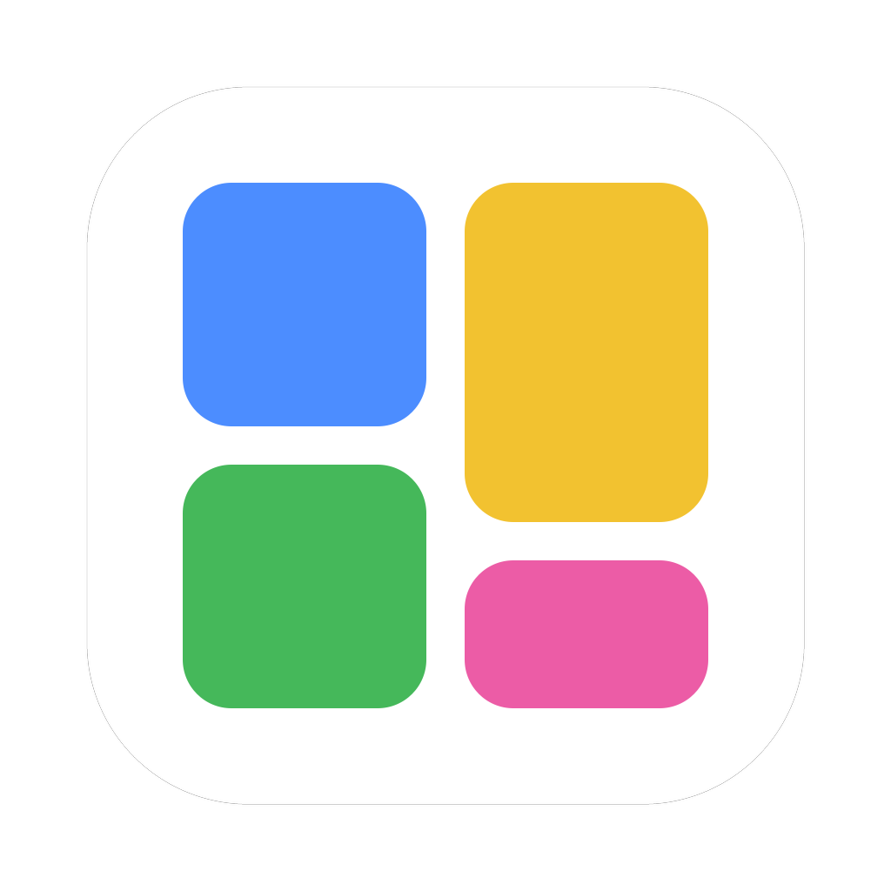

# Mina Notes

A visual workspace for notes, tasks and diagrams on an infinite canvas. Boards can contain other boards, so you can put a diagram inside a diagram as many levels deep as you like.

It runs entirely on your machine. There is no server and no account; all data is stored locally. Use it in a browser or as a native macOS app (Electron).



## Features

**Boards and nesting**
- Boards nest without limit. Click a board card to open it and use the breadcrumbs to go back up.
- Drag any card onto a board card to move it inside.
- Copying, duplicating or deleting a board includes everything inside it.
- Star boards, browse recent boards, and see every board in a tree sidebar.

**Card types**

| Card | What it does |
|---|---|
| Note | Rich text: headings, lists, quotes, code, links, colours, highlights, Markdown shortcuts |
| To-do | Checklist with progress bar, due dates and overdue highlighting |
| Link | Web link card; YouTube and Vimeo links play on the board |
| Image / Video / File | Upload, drag in or paste; full-size preview |
| Audio | Record from the microphone or upload |
| Column | Stack and reorder cards; collapsible |
| Comment | Comment thread (comments can also be added to any card) |
| Table | Editable grid with header row |
| Document | Long-form writing in a full-screen editor |
| Sketch | Freehand drawing with pen, marker and eraser |
| Colour | Colour swatch with hex and RGB values |
| Map | Embedded map for a place or address |

**Lines and arrows**
- Connect cards with the line tool or by dragging from a card's edge handle.
- Curve, label, colour and restyle lines (solid, dashed, dotted), with arrows at either end.

**Canvas**
- Pan, zoom, and fit to screen.
- Select with a drag box or shift-click; smart alignment guides and optional snap to grid.
- Resize, lock, colour, align/distribute, and change layer order.
- Copy, cut, paste, duplicate (also alt-drag), and full undo/redo.
- Paste or drop images, files, links and text directly onto the canvas.

**Organising**
- 13 templates (project plan, mind map, flowchart, moodboard, weekly planner, storyboard and more).
- Search across all boards and cards.
- An "Unsorted" inbox for quick capture, and a trash you can restore from.
- Activity feed, dark mode, keyboard shortcuts (press `?`).

**Export and backup**
- Export a board as PNG, PDF (print), Markdown or plain text.
- Back up and restore the whole workspace, including uploaded files, as a JSON file.

## AI assistant

Press **A** or click **AI** in the toolbar. Requires your own [Claude API key](https://platform.claude.com/settings/keys).

- **Flow diagrams:** describe a process and Claude designs the flowchart. It's laid out automatically, with start/end, step, decision and input/output cards, labelled Yes/No branches, and dashed lines for loops. By default it goes into a new board, so it becomes a diagram inside your diagram.
- **Documentation:** Claude writes a structured document that streams in live and is saved as a document card. Choose **Both** to write documentation from the diagram it just made.
- **Board context:** optionally send the current board's content so the diagram or document builds on what's already there.

**Token size and cost**
- **Before you send:** an exact input token count (from the Claude API's token counting endpoint), the typical output size, and the estimated cost.
- **After each request:** actual input and output tokens (including the model's thinking tokens) and the exact cost, calculated from the token counts the API returns.
- **Usage panel:** the badge in the top bar shows this month's spend. Click it to see totals for today, this month and all time, spending by feature, and recent requests, and to export everything as CSV.
- **Monthly budget:** optional; you're warned before a request would go over it.

**Models** (choose in AI settings; prices per 1M tokens, input / output):

| Model | Price | Notes |
|---|---|---|
| Claude Opus 5.5 | $4 / $20 | Default, best quality |
| Claude Sonnet 5.5 | $2 / $10 | Faster |
| Claude Haiku 5.5 | $0.10 / $0.50 | Cheapest |

A typical diagram plus its documentation costs roughly $0.10–0.20 on Opus 5.5. If a model declines a request on policy grounds, the API automatically retries on Anthropic's recommended fallback model (not available for Haiku). The usage panel shows when that happens and prices it at the fallback model's rates.

**Where the API key is kept**
- **Desktop app:** encrypted with the macOS keychain in the app's data folder. The page never sees it; all Claude calls run in the app's main process.
- **Browser version:** stored in that browser's local storage and sent directly from the page, so prefer the desktop app.
- The key is never included in workspace backups.

## Getting started

### In a browser

No install needed. Open `index.html` in Chrome, Edge or another Chromium-based browser.

If data does not persist when opening the file directly, serve the folder instead:

```bash
python3 -m http.server 8765
# then open http://localhost:8765
```

### As a macOS app

Requires [Node.js](https://nodejs.org) 18 or later.

```bash
npm install
npm start          # run the app
npm run dist       # build dist/Mina Notes-<version>-arm64.dmg for Apple Silicon
```

The build is not code-signed. The first time you open the installed app, right-click it in Applications and choose **Open**.

To build for Intel Macs, change `"arm64"` to `"x64"` (or add both) under `build.mac.target` in `package.json`.

## Data and storage

- Boards, cards and settings are saved automatically to IndexedDB, with a copy in localStorage.
- Uploaded images, videos, audio and files are stored in IndexedDB.
- Storage belongs to one browser and one address: the browser version, the `localhost` version and the macOS app each keep separate data. Move data between them with **Settings → Export backup** and **Import backup**.
- The macOS app stores its data in `~/Library/Application Support/Mina Notes`.
- Clearing a browser's site data deletes that copy of your boards, so export a backup regularly.

## Keyboard shortcuts

| Action | Shortcut |
|---|---|
| Add note / to-do / link / board | `N` `T` `W` `B` |
| Column / comment / document / sketch | `C` `M` `D` `S` |
| Line tool | `L` |
| New note anywhere | Double-click the canvas |
| Search | `⌘K` or `/` |
| Undo / redo | `⌘Z` / `⇧⌘Z` |
| Duplicate | `⌘D` |
| Delete | `Backspace` |
| Zoom in / out / 100% / fit | `⌘+` / `⌘-` / `⌘0` / `⇧1` |
| Go up one board | `⌘↑` |
| AI assistant | `A` |
| All shortcuts | `?` |

## Project structure

```
index.html          App shell
css/styles.css      All styles, including light and dark themes
js/store.js         State, IndexedDB persistence, undo/redo, data model
js/icons.js         Inline SVG icons
js/cards.js         Card types, rendering, inline text editing
js/canvas.js        Pan/zoom, selection, drag and drop, resizing, lines
js/ui.js            Toolbars, menus, panels, search, settings, sharing
js/extras.js        Document editor, sketch editor, export
js/templates.js     Templates and the starter workspace
js/ai.js            AI assistant, token/cost estimates, usage ledger
js/app.js           Startup, keyboard shortcuts, clipboard
main.js             Electron main process (macOS app window)
ai-main.js          Claude API calls for the desktop app (holds the API key)
preload.js          Narrow bridge between the page and ai-main.js
build/              App icon
```

The app is plain HTML, CSS and JavaScript with no framework and no build step. Scripts load in order from `index.html` and share a single `window.App` object.

## Limitations

- **Sharing** saves invite and link settings with each board, but nothing is sent: inviting people and live collaboration need a backend.
- **Link previews** do not fetch a page's title or description automatically; you can type them in.
- **Online only:** maps, video embeds, website icons and PNG export need an internet connection.
